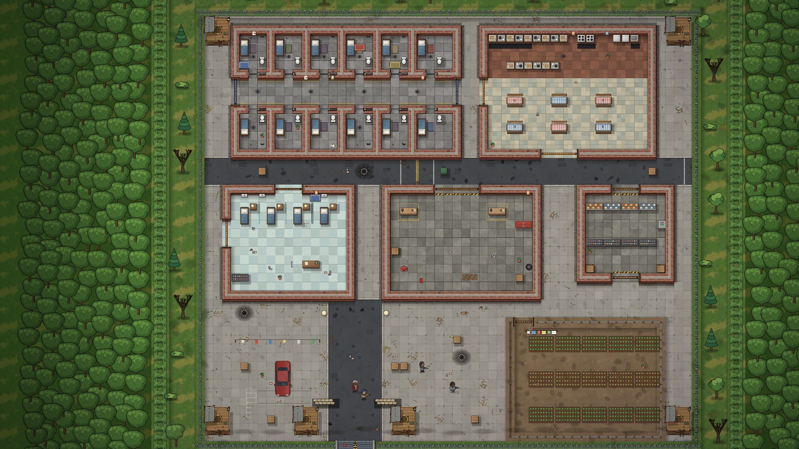
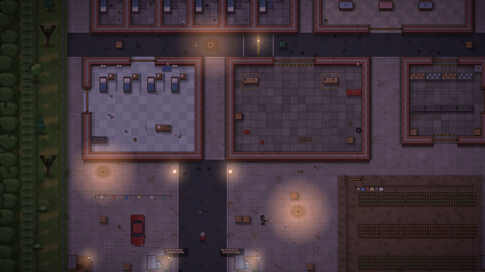
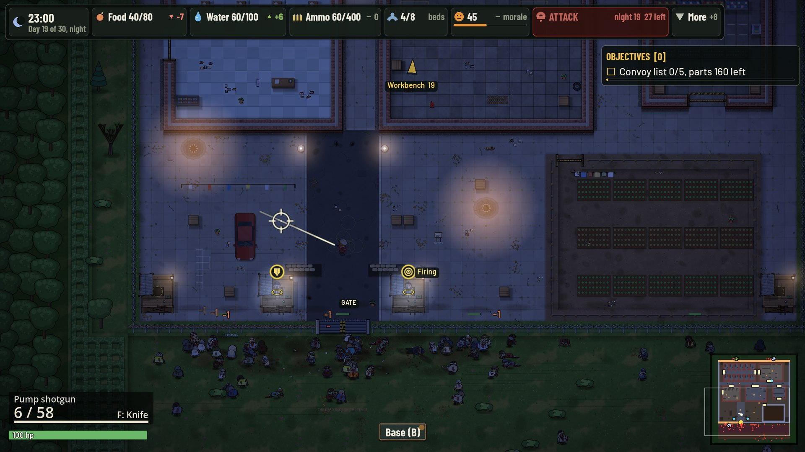
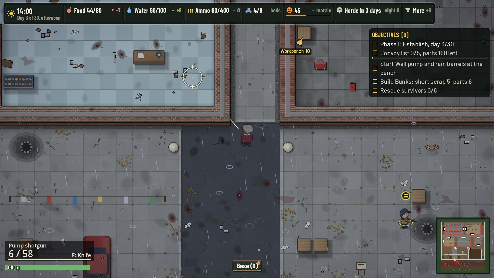
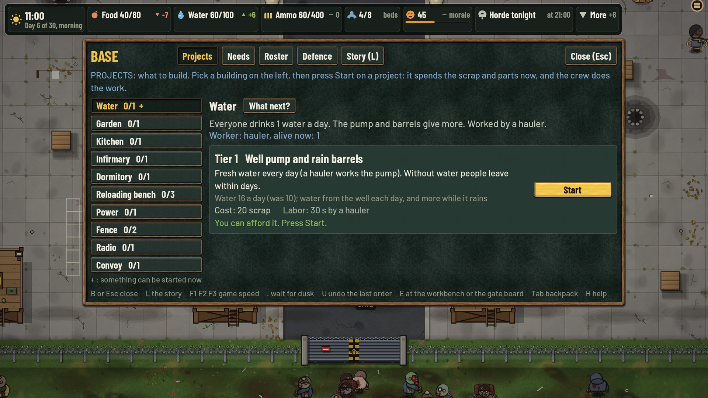
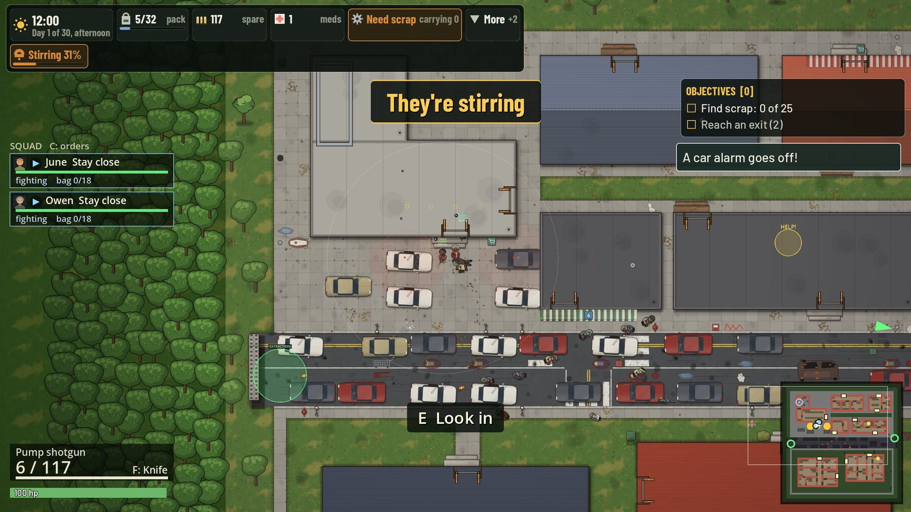
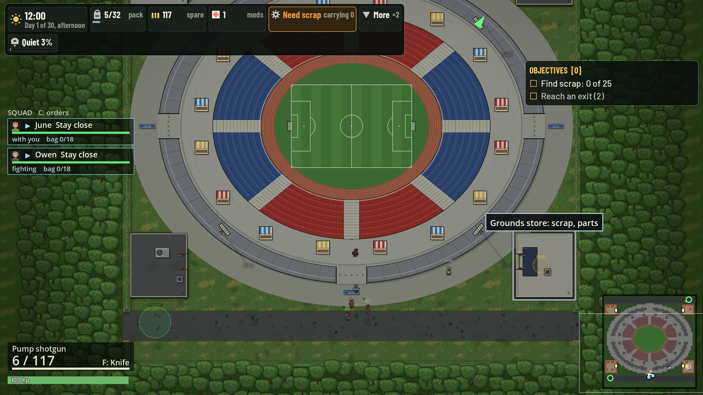

# Last Bell

A top-down zombie survival game in Godot 4.7 (GDScript). You play Ruth, a survivor who breaks into an overrun prison with three allies and clears it. Then you run it as a base for 30 days: assign jobs, build up the fence, post guards, and take raids into the dead town for scrap, food and new people. Horde nights test the walls. On day 30 a convoy arrives, and your ending depends on how you did.



| | |
| --- | --- |
|  |  |
|  |  |
|  |  |

Play it in the browser on itch.io: <https://jafforge.itch.io/last-bell>. More screenshots are in [`site/`](site/index.html).

## Run it

You need [Godot 4.7](https://godotengine.org/download) (standard build, no .NET).

```bash
git clone https://github.com/jafforgehq/last-bell.git
cd last-bell
godot --headless --path . --import   # first run only: imports the assets
godot --path .                       # or open the folder in the Godot editor and press F5
```

## Controls

Move with W A S D (X to run), aim with the right mouse button or Shift, fire with the left button, R reloads, F swings, E uses what the prompt says, Tab or I opens the backpack, B opens the Base screen. The Esc menu has a full Controls page.

## Tests

```bash
godot --headless --path . --script res://tests/run.gd              # about 4,400 checks
godot --headless --path . --script res://tests/run.gd -- --only=NAME   # one file
```

## Project layout

| Folder | What is in it |
| --- | --- |
| `scripts/` | Game code: `sim/` (rules), `prison/` (the prison base and raids), `town/`, `ui/`, `render/`, `audio/` |
| `scenes/` | Godot scenes |
| `assets/` | Sprites, tiles, sounds, fonts and data. Sprites are drawn by scripts in `tools/` (Pillow, NumPy), not by AI image services |
| `tests/` | Headless test suite |
| `tools/` | Asset generators, audits, capture and balance scripts |
| `docs/` | Design notes, audits and specs. `docs/DEV_NOTES.md` is the long development log, `STATUS.md` the current state |

## Contributing

Issues and pull requests are welcome. Run the test suite before sending a change and keep new art code-drawn or under a licence that fits [`LICENSE.md`](LICENSE.md).

## Licence

Code is MIT ([`LICENSE`](LICENSE)). Art and audio made for the game are CC BY 4.0. Fonts are OFL, the recorded sounds are Kenney CC0. [`LICENSE.md`](LICENSE.md) has the full table, including one set of sounds that is deliberately left out of this repository.
