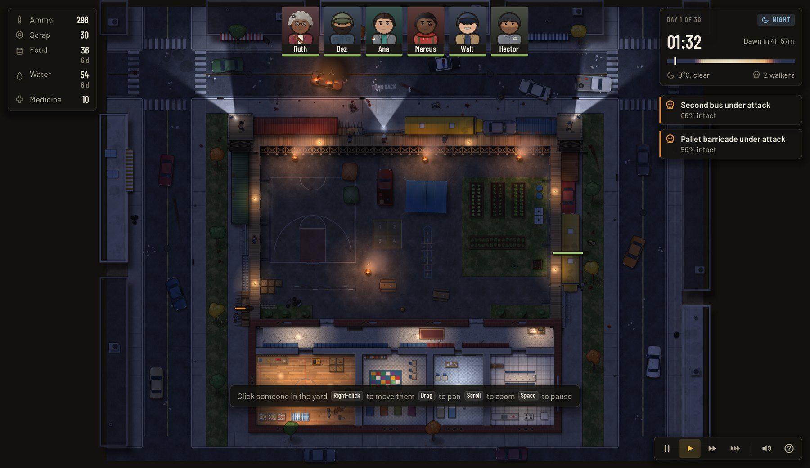
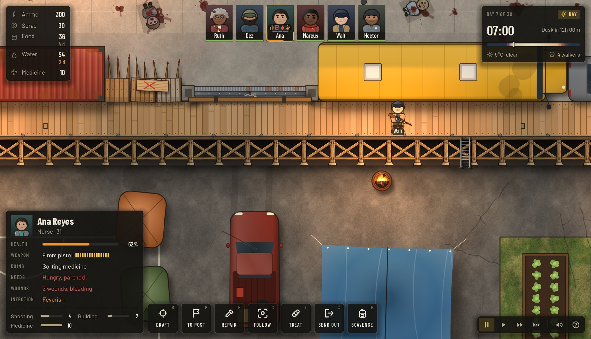
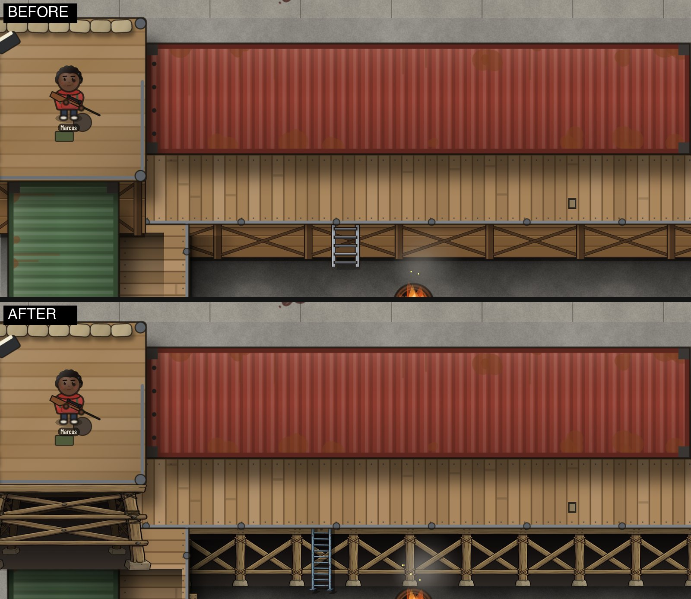
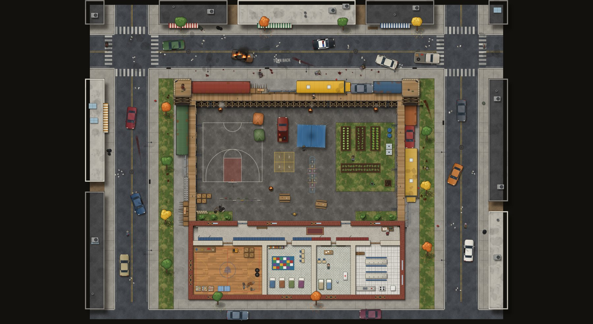

# Last Bell: full audit and roadmap

> **Status, same day (2026-10-01).** Round 0 ("truth and foundation") is done and committed; see [the plan](../superpowers/plans/2026-10-01-round-0.md) and section 7c of [the spec](../superpowers/specs/2026-09-30-colony-sandbox-design.md). Of this audit's five headline findings: **ammo is real** now (a shot needs a whole shot in the stock); **hiding in the school no longer wins** (two attackable doors, stores ruined by the dead in the yard; harness medians over 16 seeds: 19 defending against 15.5 hiding, it was 8 of 8 alive on day 20 before); **there is a goal** (victory at the dawn of day 31) but still no title screen, menus or tutorial (rounds 3-4); **the name is changed** (working title Thirty Bells; the itch.io page and the GitHub repository still carry the old one); the **prototype source is rescued**. Also done from section 6: the fixed 30 Hz rules loop, bounded path smoothing, and the quick UI fixes (tooltips, 12 px floor, contrast, alert leak, PAUSED, help, refusal toasts). The rest of the roadmap is unchanged.
>
> **Status, round 2 (2026-10-01).** The night is a puzzle now (plan: [round 2](../superpowers/plans/2026-10-01-round-2.md); numbers in section 7d of [the spec](../superpowers/specs/2026-09-30-colony-sandbox-design.md)): runners from night 4 and brutes from night 8, a plan for each night that the lookout forecasts at 17:00, a fields-of-fire view (V), an alarm that draws the dead to one wall section (L), auto-repair as a standing order (B), people on decks scratched far less, and a Big Night on night 30. The harness's informed bot (reads the plan, places the guns, rings the alarm) outlasts the naive one by seven days (median day 24 against 17 over 16 seeds, Standard). Nobody reaches day 30 on Standard yet: the informed crew runs out of ammo first, which is the workshop's job in round 3.
>
> **Status, round 3 (2026-10-01).** Done: the workshop (scrap into ammo) and a fourth site, the scrapyard (the informed bot now wins 6 of 16 Standard games), a title screen with Continue, New game, Load, Settings and Credits, a pause menu and saved settings, Orientation Day (a scripted, can't-lose first run with a coach overlay, plus eight tips), and the schoolyard-noticeboard look for the HUD and the menus (22 frames made from Meshy materials; the world art is unchanged). Still ahead: the people and storyteller round, the Town Board (the city), the demo and store round (key art, capsules, the rights audit, the web build tested in a browser).

2026-10-01 · repo HEAD `e4fa379` on `feature/colony-sandbox` · written by Claude with four read-only reviewers (code, game design, UI/UX, assets and rights). Their full reports are the appendices; this document is the synthesis, plus the things I measured myself.

How to read the tags: **(tested)** I ran it this session. **(verified)** I read the code and it says so. **(review)** a reviewer's finding I did not re-run.

---

## 0. The short version

**Verdict.** Last Bell is a handsome, solid prototype with a good rules core and almost no front door. The map, the night lighting and the sound read as a real game, the rules are deterministic and well tested (278 tests), and the HUD is better than most prototypes. But it is not yet a game that holds a player for 30 days, and it is not yet a product you can put a price on.

Five things I would want you to know first. The second one overturns something I told you in round 1.

1. **The defence is optional.** Put all six people inside the school at 07:00 on day 1 and give no other order: in 3 of 3 seeds all six were alive and unhurt on day 20, with the walls at 74-79% and 186-239 ammo left (tested). The dead cannot enter the school. A crew left at its posts loses by day 13 (median; the range was day 8 to 16) (tested). Run on to day 33 with no food or water trips at all, two seeds still had four of six alive on day 30 (two died between days 25 and 30; I did not check the cause). The best strategy in the game today is to not play it.
2. **Ammo does nothing.** The number goes down when someone shoots, but nothing checks it: with 0 ammo the crew killed exactly the same 32 walkers in a night as with 300 (tested; `sim.gd` line 652 is the only place the rules spend ammo, and nothing reads the stock to stop firing). My round-1 balance note said "ammo is the binding constraint". That was wrong: the stock hits zero around day 11-15 in the harness and the shooting simply continues. One of the five supplies is cosmetic, and the real limits are wall health and medicine.
3. **There is no goal and no front door.** No rule ever sets victory (day 31 just continues), and there is no title screen, difficulty choice, pause menu, settings or tutorial. The web build always plays Standard on a random seed.
4. **The name is taken in your niche.** "The Last Bell" is a Steam game (school horror, coming soon, ZeroHint / BellHood Games), and there is a free itch game called "Last Bell". Fix this before a Steam page exists (section 7).
5. **98% of your art could not be rebuilt.** The generator for the sprites and sounds lived in the deleted web prototype, and the only copy I could find was inside an old chat transcript that Claude Code may clean up after its retention period. I have backed the transcript up and rebuilt the prototype's source from it (section 7).

**What is good, and worth protecting.** One seeded RNG and a bit-exact save (no global random calls in the rules). A module contract that made round 1 fast to build. A HUD with 82 headless tests. Night lighting and the searchlight towers. The deck faces and the scavenging cards, which show the standard the rest of the art can reach. A balance harness that plays whole games.

**The plan in one paragraph.** Fix the truth first (ammo, the school, a goal, a fixed-step loop: days, not weeks). Then make the night a puzzle you can read and solve (information, positioning, new threats). Then build the shell (title, menus, settings, the schoolyard-noticeboard UI re-skin) and the interactive tutorial "Orientation Day" on top of mechanics that have stopped moving. Then grow the world with a drawn Town Board of 30-40 sites rather than a seamless big map. Details and order are in section 8; section 5 answers "how do we expand the whole city".

---

## 1. Where the project stands

| | |
|---|---|
| Engine | Godot 4.7.2, GDScript. Desktop Forward+, web export single-threaded (Compatibility) |
| Game code | about 8,700 lines in `scripts/` (sim 3,900, UI 2,200, render 1,400, main/world/data 1,100, audio 80) |
| Tests | 278 pass in about 50 s (6,800 lines in 22 files); the HUD has 82 of them; combat, pathfinding, input and rendering have almost none (section 6) |
| Tools | balance harness, HUD screenshot tool, icon generator, and (new) `make_deck_art.py` |
| History | 47 commits on this branch; `main` is still the published zombie game |
| Map | 84x64 tiles (5,376): one city block. A walled schoolyard (44x26 yard) plus the school building, ringed by streets. 380 objects, 23 lights, 14 wall sections with 100 attack slots, 10 spawn points on the map edge |
| Run | 30 days; 1 game hour = 20 s, so a day is 8 minutes and the 30 days are about 4 hours at normal speed |
| Assets | 33 MB: 639 PNG, 31 WAV, 5 TTF. 624 PNGs and all sounds were drawn and synthesised by code in the old prototype; 15 PNGs are cut from Meshy images (3 site cards, 12 deck pieces) |
| Web build | 26.4 MB zip (stale, from `main`); 270-360 MB of decoded textures at run time (review) |
| Speed | 50 fps by day and 44 fps at night on this Mac at 2560x1472 windowed; the game's own script cost is about 2.7 ms a frame (section 6) |

Screens: the whole map by day ([shot](img/shot_map_day.jpg)) and at night ([shot](img/shot_map_night.jpg)); the inspect panel ([shot](img/shot_hud_inspect.jpg)); the scavenging dialog ([shot](img/shot_scavenge_dialog.jpg)).

---

## 2. Game design audit

Full review: [appendix B](appendix-b-design.md). My additions are the tests.

### 2.1 What the player actually does

About ten meaningful inputs per game-day, one every 50 seconds: one scavenging trip (06:30-10:00 only), 0-6 manual repair orders, 0-4 re-posts at night, the occasional treat or exile, and speed/pause/camera. Everything else is automatic: targeting, firing, reloading, meals, bandaging, bed rest, going to posts at the bell, the dead leaving at dawn. Daytime is 52% of every 8-minute day and has one to three inputs and no threat. Skills never grow. Melee is unused.

### 2.2 The evidence that decisions barely matter (tested)

Balance harness, Standard, 8 games of 20 days each, seeds 1-8:

| Crew policy | Median day reached | Survived 20 days |
|---|---|---|
| Nobody gives any order (`--policy=none`) | 13 | 0 of 8 |
| The harness's sensible policy (repairs, scavenging, treating) | 17 | 0 of 8 |
| Everyone moved into the school on day 1 and left there (3 seeds to day 20, 2 of them on to day 33) | all six alive on day 20; four alive on day 30 | 3 of 3, nobody hurt |

All the player's care adds about four days. Hiding adds more than all of it. (The harness has a blind spot the reviewer flagged: it never repositions anyone, so "median day 17" rates a naive crew.)

The school keep works because the dead cannot enter the school building (514 tiles are solid for them), so nothing can reach a person inside it. In those runs the walls lost 21-26% of their health over 20 days with no repairs at all.

### 2.3 Where it is fun, and where it is flat

Fun now: lighting and sound at night, the alert feed's small stories, the infection dilemma (treat or exile someone you know), the three-hour scramble to save a downed person, a breach.

Flat or broken:
- **Ammo is cosmetic** (section 0). A round-3 ammo workshop would be pointless until it is gated.
- **The real constraints are wall health and medicine.** Walls total about 3,570 HP, a clawing walker does 1.2 HP a second, scrap income is about 4.5 a day (45 HP). Bandaging spends a medicine per scratch against about 1.7 a day of income. It is a depletion clock with no sinks and no growth: the base on day 30 is the base on day 1.
- **Scavenging is a chore.** About 1% of trips lose someone and 11-21% wound; the odds are hidden; whichever site is open is the right one.
- **No information.** No forecast of tonight's wave and no view of coverage. At the default night posts, 15 of the 100 attack slots are in range of nobody (review), so the first breach is predictable and invisible.
- **A death spiral.** Ana is the only Medicine skill above 2; lose her and the medicine runs out, then the shooters.
- **No goal.** "Day N of 30" is only a counter.

### 2.4 The first ten minutes

You start unpaused at 07:00 with six people standing on decorative posts, four wanderers outside and a one-line hint. There is no objective. Four real minutes pass with nothing to do, the 13:00 meal is silent, and the Scavenge button vanishes at 10:00 without explanation. The 19:00 bell is the first moment of life. Night 1 (30 walkers over about three minutes) is easy and teaches nothing. The likely quit points are minutes 2-4, the end of night 1, the first unexplained breach (days 3-8), and the repair chore.

### 2.5 Ideas to make it fun

I would add one idea to the reviewer's list as the spine of everything else: **make the night a puzzle the player can read and solve, and make the school a last stand rather than a free win.** Concretely, the dead should be able to break into the school (windows, doors), so falling back is a decision with a cost and a clock, not the optimum.

The reviewer's top 15, ranked by impact over effort (S/M/L effort). Tags: P personality, S stories, D defence, C city, R replay, B bell/school.

| # | Idea | Tag | Effort | What it fixes |
|---|---|---|---|---|
| 1 | Real ammo and fire discipline: gate firing and reloading on stock, dry guns fall back to melee, per-person policy (free / walls only / hold) | D | S | The cosmetic supply; gives melee a role |
| 2 | Standing orders and Building speed: auto-repair under 70%, auto-treat, repair speed from the Building skill | S | S | The daily repair chore |
| 3 | Lures: "alarm" the wrecked cars in the wall to choose which wall takes tonight's wave | D | S | A real defensive decision |
| 4 | Fields-of-fire overlay (V) and a 17:00 forecast from Marcus | D | S/M | Invisible blind spots; no information |
| 5 | Dawn assembly: a morning report (kills per person, wall lost, bandages used); the bell tolls once for each person lost | S, B | S/M | No sense of consequence |
| 6 | Skills grow with use; a study hall where a teacher trains a student | P, B | S/M | Static crew; uses the school |
| 7 | A storyteller deck: one event card a day at a 12:00 radio hour (supply drop, storm, fog, blackout...), driven by a hidden tension value | S, R | M | `waves.gd` is only a +10% ramp |
| 8 | Traits and barks: two each, six lines each (Ruth steady, Dez tinkerer, Marcus jumpy...) | P | M | Characters with no character |
| 9 | The Last-Bell Knock: 17:30-18:55 a survivor runs at the gate with walkers behind; open it or not; the bell shuts it | S, B | M | A moral choice with the title in it |
| 10 | Bonds, grief and exile costs between named crew | P | M | Making losses hurt |
| 11 | Scavenging in beats and scouting: decisions at 08:30, 11:00, 14:00 | C | M | Scavenging as a real choice |
| 12 | A workshop: scrap into ammo at the gym bench | D | M | A sink; needs #1 |
| 13 | Wall sockets: sandbags, spike strips, burning barrels, floodlights | D | M/L | Defence as a puzzle |
| 14 | "Class of...": pick 6 of 12 crew, two traits each, a yearbook of the fallen, a daily seed | R, B | M | Replayability |
| 15 | The Town Board (see section 5) | C, R | L | The wider city |

Foundation items to do before any of them: gate ammo, decide the school's rule, add a victory rule and the Big Night, a fixed 30 Hz loop, and a harness policy that repositions.

**Roadmap the reviewer suggests**, which I agree with: round 2 "the night as a puzzle" (#1-4, runners and brutes, the Big Night and victory, the school decision, a smarter harness bot), round 3 "days and people matter" (#5-12 plus the tutorial), round 4 "demo and replay" (a seven-day itch demo, a start screen, #14, 60-walker web performance, the rights audit).

---

## 3. UI/UX audit and redesign

Full review and the tutorial and asset lists: [appendix C](appendix-c-ui.md).

### 3.1 What exists

The HUD is built in code (1,485 lines): stores top-left, six crew cards top-centre, clock and alert feed top-right, an inspect panel and order buttons bottom-left, speed controls bottom-right, plus the scavenging dialog and a game-over screen. It is clean, consistent and tested, and the scavenging cards (Meshy illustrations) are the best-looking screen in the game.

There is no boot flow: no title screen, difficulty or seed choice, pause menu, settings, save slots, codex or credits. Esc only clears the selection.

### 3.2 Problems, ranked

High:
1. **No onboarding.** The only guidance is a hint line that disappears at the first selection and is hidden on windows narrower than 980 px.
2. **Orders are undiscoverable and refusals are silent.** The big order buttons have no tooltips, the key letters are 10 px grey, and the help panel omits half the keys. Right-click on a place nobody can reach does nothing (verified in `main.gd`: no marker, message or sound); "Draft" is jargon and drafted people stay put until R.
3. **Readability.** Text is 10-13 px, the secondary grey is 3.0-4.1:1 contrast, panels are 86% opaque, and there is no UI-scale setting. At 4K or on a Steam Deck the UI will be tiny.
4. **Colour-only state.** Health and days-left use green/orange/red only; under a deuteranopia simulation green and orange are 1.06:1 apart.
5. **Alerts.** They expire on simulation seconds (verified: a 5 s alert lasts 1.5 s at 3x speed); a wall's alert text changes with every claw so the feed is rebuilt up to 10 times a second in a siege, eating clicks; each rebuild leaks one unparented control (verified, `hud.gd:567`).

Medium: single selection with no box-select or groups (left-drag pans); WASD by logical keycode (wrong on AZERTY); no key remapping or gamepad or touch; wall health only as bars in the world with no overview; one master mute that is not saved; every sentence is a literal string (no localisation path); 29 hand-built style boxes and 54 theme overrides in one file instead of a Theme resource.

### 3.3 The new look: "the schoolyard noticeboard"

The HUD is a good dark UI with no identity. The title, the bell and the school are the identity. I generated three concept boards (27 credits) to show the direction; they are mood boards, not final art (AI text is unreliable, so the squiggles are deliberate).

*(The concept picture that stood here was made with an image model and was removed on 2026-10-17; see docs/assets-log.md.)*

Slate chalkboard panels in oak trim for the resource bar; crew as laminated school ID badges on lanyards; a brass bell clock for day and night; pinned slips for alerts; notebook paper for modals (a scavenging trip becomes a permission slip); a report card for the end screen. Bus yellow (#f0c24a, already your accent) stays the highlight. The HUD stays dark; paper appears only in modals.

*(The concept picture that stood here was made with an image model and was removed on 2026-10-17; see docs/assets-log.md.)*

The key art above is a candidate for the title screen and the Steam capsule (after a proper pass). Note what it shows: the bell, the towers and searchlights, the bus and containers, six silhouettes. It is the game.

For the standard of finish the rest of the art can reach, here is the platform rework from earlier today (the same pipeline: an AI reference picture, processed by a script into pieces the game assembles):

### 3.4 How to build it without a 1,500-line rewrite

- One Godot **Theme** resource generated by a script (as `make_icons.gd` already does for icons), set as the project default so tooltips match, with type variations for chalk panels, paper panels, slips, badges and buttons. A small `UiKit` factory replaces the hand-built style code. Keep the HUD's field names so the 82 tests survive.
- 9-slice frames at 2x (192 px sources). **Generate seamless materials (slate, oak, ruled paper, brass, cork, carbon paper) with the image model and assemble the frames with a Pillow script** (the same pattern as `tools/make_deck_art.py`), so the 9-slice edges are exact. Do not prompt for finished frames.
- Layout at 1280x800: stores shelf and a 14-pill wall-health strip top-left, six 72x96 badges top-centre, a bell clock and at most four slips top-right, selection and order bar bottom-left (labels at 14 px, tooltips that say what and why disabled), a minimap bottom-right. 1920x1080 is the same layout at UI scale 1.35. Nothing smaller than 12 px.
- Fixes that are cheap and should not wait: tooltips and refusal toasts, the 12 px floor, contrast, alert leak and rebuild, type icons for alerts (wall, wound, food, water, ammo, scrap, medicine, trip, fever, bell, breach), Tab skipping the dead and the away.

### 3.5 New assets, in batches

The reviewer's list (appendix C) in short: **A** seamless materials; **B** about 20 assembled frames (panels, paper, slip, badge, dialog, tooltip, toast, bars, key chips, four button kinds in four states, pin); **C** about 70 icons at 128 px (redo the 34 and add bell, ladder, wall N/W/E, breach, bandage, pill, canteen, crate, hammer, skull and so on); **D** eight cursors; **E** illustrations (chalk doodles, a narrator bust, six crew portraits in three states, two stamps, six more site cards); **F** key art (logo, a four-layer title screen, a loading screen, the Steam capsules); **G** about twenty UI sounds and four music loops. My rough estimate for A-F with the image model is 400-600 credits, a quarter of your balance. Log the prompt, model and date of every image: the rights audit and Steam's AI disclosure need it (section 7).

---

## 4. The interactive tutorial: "Orientation Day"

Full design: [appendix C, section 3](appendix-c-ui.md). Summary:

- **A scripted scenario, about nine minutes, that cannot be failed.** It runs on Story rules with a wall-health floor, its own seed and a scripted night, and it ends by starting a normal Standard run. It is offered on first launch and from the menu, and it can be skipped or replayed.
- **Eighteen steps**, each with a done-condition read from the sim and a highlight: pan and zoom; click Ruth; right-click to move; R to release; Hector to a post by the ladders (people can only reach the walkways at ladders); C to follow; repair the damaged bus (one scrap per 10 HP); read the stores and days-left; send Ana scavenging (G); the 19:00 bell; Marcus's range ring and rounds; click an alert; Ana bandages Walt; treat or exile the feverish Hector (T, X); the dawn save; wrap-up.
- **Architecture.** `assets/data/tutorial.json` (text, targets, which inputs are allowed, done-conditions); a `scripts/ui/coach.gd` overlay on its own layer (dim, ring, arrow, callout, a Skip button); a gate in `main.gd` that refuses every order except the current step's while a step is active; a `prefs.gd` file for "seen" flags. Scripted beats live in a `Scenario` subclass on the rules side, so the whole tutorial is testable headless.
- **Hooks that already exist:** the events `bell`, `day_start`, `banner`, `claw`, `hammer`, `turned`, and alerts by id. Hooks to add: an `order` event on every command, a `repaired` event, `trip_out`/`trip_back`, and an `anchor_rect(name)` on the HUD so the coach can find a button even though gizmos are rebuilt.
- **Contextual hints in normal runs** (first dusk, first wound, low water, a breach) reuse the same coach and flags, which also covers players who skip the tutorial and the web demo.

**Why it comes after round 2.** It teaches ammo, the school, repairs and orders, all of which are about to change. Build the coach and the gate early (they do not depend on the rules), write the steps last.

---

## 5. Expanding the city

### 5.1 What the map is now

One city block: the schoolyard in the middle, the school building at the bottom, and a ring of streets, sidewalks and grass. Neighbouring buildings appear only as flat rooftops at the edges (four along the top, two on the left, three on the right); they are not enterable. Everything beyond the 84x64 tiles exists only as three site cards (pharmacy, hardware store, neighbourhood houses), a scavenging trip being a roll of dice and a 16:00 return.

### 5.2 Three ways to grow

| | A. Town Board: a drawn city map and abstract expeditions | B. Playable site maps: small tactical maps you enter | C. A seamless big map (3x3 blocks, about 250x190 tiles) |
|---|---|---|---|
| What the player gets | An illustrated map of 6-7 districts and 30-45 sites with fog of war and routes; send parties, scout, decide mid-trip | Walk into the pharmacy, police station or hospital wing in real time | Roam the whole city with the compound at the centre |
| Cost | Medium-large: data, UI, events, 25-35 site illustrations, one map | Large per site pack, plus a map-authoring tool, a state switch and indoor AI | Extra-large: new pathfinding, streaming, authoring tool, 9x the art |
| Engine risk | Low: nothing about the 84x64 map changes | Medium | High (measured, 5.4) |
| Fits the web demo | Yes | Yes if the sites are small | Doubtful |
| Replayability | High: sites drawn per seed, districts unlock | High | High, but only after years of content |

*(The concept picture that stood here was made with an image model and was removed on 2026-10-17; see docs/assets-log.md.)*

### 5.3 Recommendation

**A first, B for three to five hero sites later, and grow the home map modestly. Do not build C now.**

1. **The Town Board.** The strategic layer is where "the city" lives, and it is where your game's decisions are: where to send whom, how far, how risky, what to leave behind before the bell. Each site has a type, a distance in hours, a danger, a loot table, a state (unexplored, cleared, picked over, occupied, burning) and event hooks. Expeditions become two or three beats (arrival, a choice, the return) instead of one roll. Scouting (Marcus on the roof, a radio lead) reveals what is where. Districts give a reason to push outward: the hospital for medicine, the industrial yard for scrap and a workshop, the police station for weapons, the radio tower for the rescue that ends the run. This also gives the Big Night and the 30-day goal a destination.
2. **Hero sites (B).** Pick three to five (pharmacy, police station, hospital wing, supermarket, bus depot) and build them as 40x30 maps on the same engine once the map pipeline exists (5.6). Hold this until the Town Board has proven the loop.
3. **Grow the home.** The four rooftops at the map edge and the ring road are room to claim: extend the walls to take in the next lot, add a second gate, use a rooftop as a lookout. This needs build tools, which the game does not have yet.
4. **Not now: a seamless open city.** The engine and the content pipeline are not ready for it, and a bigger world will not fix a game whose night is not yet a puzzle.

### 5.4 What must be fixed in the engine first (measured)

I benchmarked the pathfinder on city-like grids (blocks and streets with 3% clutter) headless on this Mac:

| Grid | Tiles | Raw A* corner to corner | `Pathfinder.find()` corner to corner | A short path (up to 14 tiles) |
|---|---|---|---|---|
| 84x64 (today) | 5,376 | 0.10 ms | 13 ms | 0.16 ms |
| 168x128 | 21,504 | 0.37 ms | 65 ms | 0.20 ms |
| 252x192 | 48,384 | 1.1 ms | 137 ms | 0.19 ms |
| 336x256 | 86,016 | 2.5 ms | 272 ms | 0.17 ms |

The A* itself is fine. **The string-pulling that follows it costs about 100 times as much and grows with the square of the path length** (`pathfinder.gd:smooth()` tries a line-of-sight check from each point to ever-nearer later points). Today it already costs about 13 ms for a 50-cell path in cluttered ground, and the code review found "path storms" at dawn when every walker retreats in the same step. Fixes: smooth forward (each anchor extends until blocked), cap the work per step, back off after failures, and for many walkers sharing a goal use one flow field instead of one path each. The review also found a probable freeze when a walker in the yard targets a sentry on a tower (a failing A* every step); I have not reproduced it.

Other engine limits, in the order they bite (appendix A): **no authoring pipeline** (the map is one generated JSON line from a prototype that no longer exists, with derived data baked in and the compound's constants hard-coded in a dozen places, so a smaller or bigger map crashes `Sim._init`); **texture memory** (all imports are lossless, 270-360 MB decoded now, about 1.4 GB at four times the content); **startup work** (the light textures are baked in GDScript, about half a second to a second); **sim cost** (the separation pass is O(n squared) over all walkers including corpses); **draw cost** (the lights, below).

### 5.5 Art and credits for the Town Board

A drawn map (one large image plus a tinted tile per district), 25-35 site cards in the style of the three you have (9 credits each, about 250-300 credits), icons for the site types, and the fog-of-war overlay done in code. Cheap relative to what it buys.

### 5.6 The pipeline you need whichever option you choose

A diffable map source (Tiled, or a Godot TileMap scene, or at minimum a readable JSON with ASCII terrain and props by name from a catalogue), a `tools/bake_map.gd` that emits chunks, solid grids, wall tiles and attack slots, and a validator that runs in the tests (the yard is sealed for the dead, posts are reachable, spawns are free). Split `World` into a node-free `MapGrid` (the grids and one pathfinder) and a chunked `WorldView` that builds sprites, details and lights near the camera and frees them beyond.

---

## 6. Code, architecture and performance

Full review with line numbers: [appendix A](appendix-a-code.md).

### 6.1 Verdict

The rules layer is the strong part: one seeded RNG, an atomic bit-exact save, 278 tests with fuzz and replay checks, a module contract that works. The platform around it will not carry a bigger game yet: the sim steps at the display rate, needs a real `World` node tree, is wired to one compound, runs per-zombie A*, and loads uncompressed per-instance textures from a map nobody can author. No crash or data-loss bug was found in normal play.

### 6.2 Findings that matter most

| # | Severity | Finding |
|---|---|---|
| 1 | High (verified, tested) | Ammo never gates shooting (`sim.gd:635-652`). |
| 2 | High (verified) | The sim steps once per frame with the frame's own `dt` (`main.gd:509-515`), not at a fixed rate. At 120 Hz the rules take four times the steps of the harness and tests; the separation pass and the `rng < dt` draws change with frame rate, so a seed does not replay the same game on two machines. Fix: a 30 Hz accumulator. |
| 3 | High (review) | Path storms at dawn and a probable freeze on tower sentries (above). |
| 4 | High (review) | Texture memory: lossless imports upload uncompressed, 240 MB at start; walls and roofs alone are about 115 MB. A web-demo risk now. |
| 5 | High (review) | `map.json` has no source, no baker and no validator (above). |
| 6 | Medium | The separation pass is O(n squared) over corpses too. |
| 7 | Medium | Reference cycles leak a whole `Sim` on every New game or Load. |
| 8 | Medium | Hunters keep their reserved wall slots until they die, starving later arrivals. |
| 9 | Medium | Saves refuse other versions (no migration), sections are not validated before they are applied (a half-applied load is possible), one autosave slot. Fix before any Early Access save exists. |
| 10 | Medium | Presentation lives in the rules (alert text, thresholds, `SIDE[...]` lookups), which blocks the tutorial, localisation and a UI rewrite. |
| 11 | Medium | Hard-coded keys, no InputMap, no gamepad, no pause on focus loss. |
| 12 | Low | The event list is only drained by the main scene, so headless games keep every claw and shot. |

### 6.3 Performance (tested, this Mac, windowed at 2560x1472)

- **The game's scripts are cheap.** In an instrumented scratch copy (the repo was not touched) the whole `_process` costs 0.6 ms a frame on a quiet day (the rules step 0.45 ms) and 1.4 ms at night with eight walkers (rules 1.2 ms); the draw callbacks add about 2 ms (the fire nodes 1.0, the pawns 0.7). The frame pacing of about 50 fps on this machine does not depend on scripts: it was unchanged with the HUD off, MSAA off, or a quarter of the pixels.
- **The lights are the cost.** At night with the lamps on, 44 fps and 26 ms of main-thread time; with lights off, 49.6 fps and 19 ms; at a quarter of the pixels, 56.6 fps. Lighting is the setting to expose (a quality option, a cap on live lights) and to budget as the map grows (the review counts 92 lights at four times the map).
- **Web will be slower** than any of this (single-threaded WebAssembly). Plan on a 60-walker test on the web build before the itch demo.

### 6.4 The tests

Strong: medical 65, scavenging 38, supplies 36, save 19 (replay after load), HUD 82 with fuzz and real clicks; any logged error fails a test. Uncovered: combat, zombie states, attack slots, separation, retreat, the pathfinder, `main.gd` (input, camera, picking), every render node, audio. Brittle: the HUD tests depend on two awaited frames and pixel overlaps; some balance tests pin literal numbers; there is no CI.

### 6.5 Refactors to do before adding features

1. A fixed 30 Hz loop, event draining and dt-scaled separation (S). 2. A node-free `MapGrid` and a Sim that needs no `World` or FX nodes; break the reference cycles (M). 3. The map pipeline (L). 4. Navigation: flow fields, a per-step path budget, a spatial hash; zombie types as data (M-L), which runners and brutes need. 5. A command-and-event layer with ids instead of strings, an InputMap, and a scene/theme HUD (M-L). 6. Save v2: schema version, migrations, validation, slots (M).

---

## 7. Assets, rights, the name, and release readiness

Full review: [appendix D](appendix-d-assets.md).

### 7.1 Where everything came from

| Group | Origin (from git history and the old transcript) | Risk for a paid release |
|---|---|---|
| Objects, pawns, portraits, trees, walls, weapons, effects, terrain (624 PNGs) | Drawn by code in the deleted web prototype (Canvas2D) and baked on 2026-09-29; no reference images | Low: no third-party art |
| All 31 sounds | Synthesised in code (Web Audio), rendered to WAV | Low; quality is weak (24 of 31 peak below -15 dBFS, the scrapes about -50) |
| UI icons | 22 from LLM-written SVG paths, 12 from `make_icons.gd` | Low |
| Fonts | Barlow and Barlow Condensed, SIL OFL 1.1 | Low: ship the licence text |
| 15 PNGs cut from Meshy images (3 site cards and the 12 deck pieces; the 3 reference pictures are in `tools/art_src/`) | Meshy `text_to_image`, nano-banana-pro | Medium: depends on your plan at generation time and on the model's own terms |

Meshy: the balance history (499, 248, then 2,043) is more than the Free tier gives, so a paid plan is likely, but that is inference. Keep the invoices, task ids and prompts. AI output may have weak copyright protection even where the licence is fine, and Steam asks you to disclose AI-generated content players see (your itch page already says yes).

Other soft spots: "walker" appears in eight UI strings and is Walking Dead vocabulary; the red-cross cabinet and Ana's badge use a protected emblem (use green); the stock Godot icon and splash must be replaced; there are no credits.

### 7.2 The generator source: rescued

The web prototype went to the Trash on 2026-09-29 and I could not find it there (the reviewer could not list the Trash, and Spotlight finds no `bake.js`). The only trace of `bake.js`, `pawn.js`, `props.js`, `terrain.js`, `audio.js` and the rest was inside an old transcript, and Claude Code cleans up old transcripts after a retention period (30 days by default, as I understand it; your settings do not override it). **Done today:** I copied the transcript (50 MB) and rebuilt the prototype's source by replaying every Write and Edit call on it: 54 files, 64 writes and 104 edits applied, none failed, and the main art and audio files pass a JavaScript syntax check. It is in `~/last-bell-prototype-recovered/` (outside the repo; see its `README.txt`). It will not run as-is (no `package.json` or `node_modules`, and anything done by shell commands is not captured), but it is the source of record for how every sprite and sound was made.

### 7.3 The name

"Last Bell" is not unique, and one hit is in your genre:

- **The Last Bell** on Steam: an asymmetrical multiplayer horror game set in a cursed school, developed by ZeroHint, published by BellHood Games, "Coming soon" with no date ([store page](https://store.steampowered.com/app/3719170/The_Last_Bell/)).
- **Last Bell** on itch.io: a free 2.5D puzzle-horror jam game by BrinRot Studios ([page](https://brinrot-studios.itch.io/last-bell)), and **After The Last Bell** ([page](https://luigiwuigi.itch.io/after-the-last-bell)).
- A Google Play app called "The Last Bell Epic Zombies" showed up in search results; its page returned 404 when I fetched it, so treat it as unverified.
- A quick search found no registered trademark; that is not conclusive (a proper USPTO and EUIPO search is cheap and worth doing).

Titles are not exclusive, but a same-theme Steam game with almost your name makes you hard to find and invites confusion. Options: keep "Last Bell" as the franchise with a strong subtitle ("Last Bell: The Thirty Days"), or rename around the setting. This is your call; I can brainstorm names when you want.

### 7.4 Before a Steam page: the checklist

Prove the Meshy plan and keep the records (S). Rights ledger and a credits screen: Godot's MIT notice, Barlow's OFL (S). Steam AI disclosure to match itch (S). New icon, splash, window title, version; a custom user-data directory so renaming does not move saves (S). Exclude `tests/`, `tools/` and `docs/` from the export, which currently ships them (S). Windows, macOS (signing and notarisation) and Linux export presets (M). A pause and settings menu (M). An audio pass and a music plan (M). Store art, 1920x1080 screenshots and a trailer (M). GodotSteam, cloud saves, achievements (M). The name check and the green cross (S). Texture compression (M). An error-log attach and a report link (S). Controller support and key rebinding (L). String externalisation and fallback fonts (L; defer to Early Access).

Web notes: the single-threaded export needs no special headers, which suits itch; the stale zip is 26.4 MB; audio waits for the first click; touch is not supported; F5 for quick-save may collide with the browser's reload (unverified).

---

## 8. Roadmap and decisions

Each round ends with something you can play and a question it answers.

| Round | Contents | What it proves |
|---|---|---|
| **0. Truth and foundation** (days) | Gate ammo with a dry-gun fallback and a retune; decide the school (the dead can break in; falling back costs); a victory rule and the Big Night trigger; a fixed 30 Hz loop; path-smoothing fix; the quick UI fixes (tooltips, refusal toasts, 12 px floor, contrast, alert leak); a harness bot that repositions; name decision; back-ups (done) | The numbers mean what they say; hiding is not the best strategy |
| **2. The night as a puzzle** | Runners and brutes; lures; fields-of-fire overlay and forecast; standing orders and Building speed; dawn assembly; the Big Night | Information and positioning change outcomes (an informed bot beats a naive one by 3+ days; testers can say why they lost) |
| **3. The shell** | Title, new-game setup, pause, settings, slots; the Theme and UiKit port; the first art pass (materials, frames, icons); Orientation Day and the hints | A new player gets through the first ten minutes unaided |
| **4. People and the city** | Skills growth, traits, bonds, a storyteller deck, the Town Board with 30-40 sites and scavenging beats, the school fall-back, the Last-Bell Knock | Three retellable moments a run; no dead time |
| **5. Demo and store** | A seven-day itch demo plus a scaled Big Night, 60-walker web performance, save v2, export presets, the rights ledger, key art, capsules, a trailer | The hook: 40%+ reach night 3, median session 40+ minutes, wishlists |

**What I need from you**
1. **Go on round 0**, or tell me what to reorder. I would start there: it fixes things that make every later round's numbers meaningless.
2. **The school's rule.** My recommendation: the dead can break into the school after the yard falls, so it is a last stand with a clock, not a bunker.
3. **The look.** Is "the schoolyard noticeboard" the right direction? If yes I will start the materials and the Theme in round 3, in parallel with the rules work (they touch different files).
4. **The city.** Town Board first (my recommendation), yes or no?
5. **The name.** Keep with a subtitle, or rename?

---

## 9. What I ran for this audit

- Four read-only reviewers read the code, the data, the HUD and the assets and git history (appendices A-D).
- **Benchmarks** (this Mac, from the repo with the camera and size flags): windowed runs of 330-360 frames by day and at night, with lights off, a quarter of the pixels, no HUD and no MSAA; an instrumented scratch copy of the project for per-function costs; a headless pathfinder benchmark on four grid sizes.
- **Game tests:** the balance harness at 8 games of 20 days with the default policy and with `--policy=none`; a one-night run with 300 and with 0 ammo; the school-keep run (everyone sent into the school on day 1) on three seeds to day 20 and two seeds to day 33.
- **The web:** a name search and fetches of the Steam and Google Play pages.
- **Images:** three concept boards (27 Meshy credits).
- The small scripts for the ammo check, the school-keep run and the pathfinder benchmark are in [`evidence/`](evidence/) (a `.gdignore` keeps Godot from importing them); run them with `Godot --headless --path . --script docs/audit/evidence/<name>.gd`.

Appendices: [A code](appendix-a-code.md) · [B design](appendix-b-design.md) · [C UI and tutorial](appendix-c-ui.md) · [D assets and release](appendix-d-assets.md).
